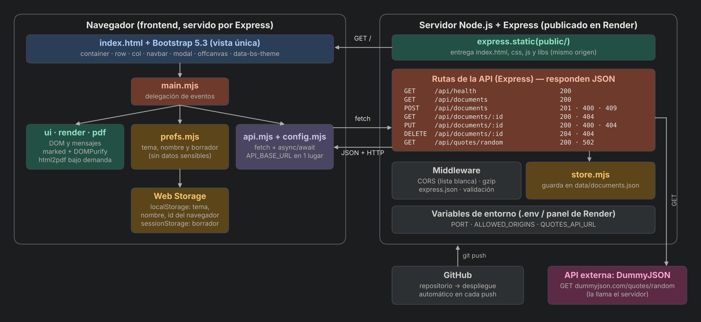

# Editor Markdown

Editor de Markdown con **vista previa en vivo**, **documentos guardados en un servidor propio** (Node.js + Express) y **exportación a PDF**. Proyecto del segundo corte de Desarrollo Web (UNISANGIL).

**Aplicación publicada:** _(pega aquí la URL de Render)_

## ¿Qué hace?

- Escribes Markdown a la izquierda y ves el resultado a la derecha, al instante.
- Guarda, abre, edita y elimina documentos en el servidor (cada navegador ve solo los suyos).
- Inserta una cita aleatoria (el servidor consulta una API externa).
- Exporta la vista previa a PDF, abre y descarga archivos `.md`.
- Tema claro/oscuro, nombre y borrador recordados en el navegador.

## Cómo ejecutarlo en tu computador

Requisitos: [Node.js](https://nodejs.org) 20 o superior.

```bash
git clone <URL-de-tu-repositorio>
cd editor-markdown
npm install
cp .env.example .env     # en Windows (PowerShell): Copy-Item .env.example .env
npm start
```

Abre <http://localhost:3000>. Con `npm run dev` el servidor se reinicia solo al editar el código. `npm test` ejecuta las pruebas de la API.

## Diagrama de componentes



## Estructura

```
server/
  index.mjs          arranque: lee variables de entorno y levanta Express
  app.mjs            middleware (CORS, compresión, JSON), rutas y manejo de errores
  routes/            documents.mjs (CRUD) y quotes.mjs (API externa)
  store.mjs          persistencia en un archivo JSON
  validators.mjs     validación de lo que llega al servidor
public/
  index.html         vista única, con Bootstrap
  css/style.css      tema, foco visible y estilo de la vista previa
  js/                módulos .mjs: main, api, config, prefs, ui, render, pdf
  libs/              Bootstrap, marked, DOMPurify y html2pdf (copias locales)
tests/api.test.mjs   pruebas de la API
```

## API

| Método | Ruta | Respuesta |
|---|---|---|
| GET | `/api/health` | 200 `{estado}` |
| GET | `/api/documents` | 200 lista de documentos (resumen) |
| GET | `/api/documents/:id` | 200 documento · 404 |
| POST | `/api/documents` | 201 creado · 400 datos inválidos · 409 límite de documentos |
| PUT | `/api/documents/:id` | 200 editado · 400 · 404 |
| DELETE | `/api/documents/:id` | 204 · 404 |
| GET | `/api/quotes/random` | 200 `{texto, autor}` · 502 si falla la API externa |

Las rutas de documentos exigen la cabecera `X-Client-Id` (UUID anónimo que genera el navegador).

## Seguridad

- **XSS:** la vista previa pasa por DOMPurify antes de usar `innerHTML`; títulos y mensajes se insertan con `textContent`.
- **Validación en el servidor:** tipo, longitud y formato de todo lo que llega (`validators.mjs`).
- **CORS:** solo el mismo origen y los de `ALLOWED_ORIGINS`; los demás reciben 403.
- **Variables de entorno:** configuración en `.env` (ignorado por Git). El proyecto no usa claves secretas; si se usara una, viviría ahí.

## Contraste medido (WCAG, mínimo 4.5:1 en texto y 3:1 en el foco)

Texto del cuerpo: 15.4:1 (claro) / 11.9:1 (oscuro) · texto secundario: 6.8:1 / 7.3:1 · botones: entre 4.5:1 y 4.7:1 · alertas: entre 7.2:1 y 10.8:1 · foco visible: 6.4:1 en ambos temas · vista previa: entre 6.4:1 y 15.4:1.

## Optimizaciones aplicadas

1. **Carga perezosa:** `html2pdf` (~920 KB) no se descarga al abrir la página; se carga la primera vez que se exporta un PDF.
2. **Compresión gzip** de las respuestas con el middleware `compression`.
3. **Caché de 30 días** para `/libs` (archivos que no cambian).

El informe de Lighthouse está en `docs/` (agrégalo después de ejecutarlo sobre la URL publicada).

## Despliegue

Un solo servicio en Render: el mismo Express sirve el frontend (`public/`) y la API, así el frontend usa una ruta relativa y no hay problemas de CORS. Variables: `NODE_ENV=production`. Comando de build: `npm install`; de inicio: `npm start`.

> Nota: en el plan gratuito de Render el disco es temporal; los documentos guardados pueden perderse al reiniciar el servicio. Para persistencia real se usaría una base de datos.

## Librerías (copias locales, versiones fijas)

Bootstrap 5.3.8 · marked 18.1.3 · DOMPurify 3.4.17 · html2pdf.js 0.14.0
